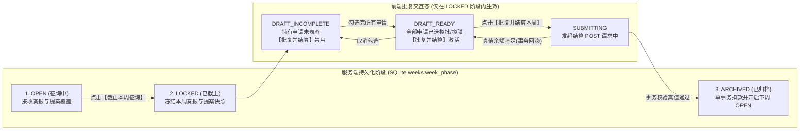

# Simu-Emperor：地图交互与官员通信设计方案（v2.2 · 简约地图界面 + EU4 空间布局版）

2026-11-03 · Argon High 设计与重构，Rocky 核验。

本文在保留 v2.1 全部周次状态机、账目结算、OAR 接收回执与权限隔离契约的基础上，按照已确定的简约地图界面方向（仅参考 EU4 空间布局，底层地图与视觉表现参考 `jiangshan-map`）更新空间布局与视觉规范。已确定的产品方向与实现建议在第零节分开列明。

---

## 零、约束边界与方案归属

1. **用户已拍板的核心约束**
   * **项目定位与技术方向**：浏览器端帝王策略游戏，全项目重启并以全栈 TypeScript 重写；抛弃旧 Python 代码、旧事件总线与旧聊天界面。
   * **地图与交互体验**：**空间布局**参考 EU4（顶部紧凑资源与阶段条、右上周次推进与结算操作、左侧可收起政务面板、右上朝堂总览大纲、右下地图图层与视角控制）；**视觉风格与底层地图**参考 [江山时序（`jiangshan-map`）](https://github.com/DeanChensj/jiangshan-map) 的简约历史地图界面（浅暖宣纸底图、地形晕渲与水系湖泽、半透明奏报晕染、简洁浅色卡片与细分割线，去除繁复鎏金边框、纹章、挂旗、画框与深色石板材质）。
   * **首版玩法与时间粒度**：首版仅含内政、财政、救灾（不含驻军、外交、宗教、阶层、建筑队列或自动倍速流逝）；按周推进；先行小范围调试。
   * **外部官员与通信参考**：官员由外部 Agent 经本地 OAR（`@botiverse/oar@0.84.0`，Node 24+）接入，游戏服务端不托管模型密钥；通信机制参考 Cumora。
   * **信息可见性原则**：正常模式仅展示官员奏报值，调试模式才可查看服务端真实状态。
2. **Argon 提出的实现与验证建议（待工程实装检验，非用户锁死指令）**
   * 具体工程选型采用 `React + Vite + Hono + SQLite`；首轮验证规模采用“3 个可交互州 + 3 个外部 OAR 官员会话 + 4 周剧本”；以及下文定义的边缘浮动布局、二元批复、兼报权限与全部交互细则。
3. **待用户后续决定的设定项（不阻塞本交互设计）**
   * 游戏世界背景采用“中国历史风格州郡”还是“架空帝国州郡”留待用户拍板；本文档与原型期统一使用中性的**“甲州、乙州、丙州”**及**“地理背景区（未启用）”**占位。

---

## 一、屏幕空间布局与简约地图界面基线

### 1. 全幅地图底层与四区简洁浮动布局（覆盖 1586×992、1440×900、1280×800 与 390×844 窄屏适配）
* **底图与可见性边界**：直接适配 `DeanChensj/jiangshan-map`（commit `a9cd67c3c4c5eef5902d31104df9b5a7ec83aa0e`，GPL-3.0，详见 `THIRD_PARTY_NOTICES.md`）的浅暖历史地图底层占满 100% 视口（`100vw × 100vh`），包含 `MercatorProjector` 球面墨卡托投影、配准地形晕渲底图（`terrain_relief.webp`）、去重省界与海岸轮廓线、分级干支流河网与湖泽水系（`清河`、`沧澜水`），以及纯 SVG `viewBox` 缩放平移相机。首轮启用甲、乙、丙三州为**“当前剧本可交互地区”**（采用 `mix-blend-mode: multiply` 的低透明奏报水彩晕染、治所与城邑标注，保留底层山川河网清晰可见）；周围其余区域标为**“地理背景区（未启用）”**。
* **仅参考 EU4 空间分区，采用温暖浅象牙白面板（`rgba(250, 247, 242, 0.96)`）、`1px` 细分割线、宋体标题/键值与朱砂重点色组织四大功能区（视觉规范详见 [DESIGN.md](../../DESIGN.md)）**：
  1. **顶部统一朝堂栏（`.court-top-bar`，桌面高 `52px`/`50px`/`48px`）**：左区展示 `朝廷存银 X.X万两` | `朝廷存粮 X.X万石`、`来源：第N周度支奏报` 胶囊（未奏报时显式标红 `本周未奏报（未知）`）及开启调试时的 `[真值 ...]` 胶囊；中区（两侧配 `1px` 竖向分割线）放置 `第1周～第4周` 串联进度与历史回看胶囊（及 `返回第N周` / `四周已完结` 状态）；右区放置 `[同步]`、`[截止征询]`、`[批复结算]`、面板收起时的 `[展开奏报]`，以及低对比下划线 `[调试]` 与 `[凭证]` 入口。
  2. **左侧《朝堂政务面板》主窗（`.left-court-sheet`，桌面宽 `404px`/`386px`/`360px`，`本州奏报` 页签高 `702px`/`684px`/`636px`，可按 `✕` 或 `Esc` 收起）**：参考 EU4 左侧省份面板位置，顶部设 27px 宋体州名标题（如 `乙州 | 第2周官员奏报 · 洪灾`）、窄屏三州切换胶囊（`甲`/`乙`/`丙`）与 `✕` 关闭按钮；下方设等宽三页签（`本州奏报` | `朝堂会话` | `提案批复`，激活态配 `2.5px` 朱砂底线）。`本州奏报` 页签采用无嵌套框的 **5 行细线宋体键值表**（`灾情状态`、`可支配存粮` + `已扣本周支出` 副注及悬停完整公式、`可支配存银`、`本州赈灾需求`、`向朝廷请拨`）、`奏折摘要` + `来源：第N周` 正文，以及底部并排双按钮 `[传讯{X}州官员]` 与 `[审阅{X}州提案]`。
  3. **右上《各州奏报》精简总览（`.right-court-outliner`，桌面宽 `324px`/`312px`/`296px`）**：以 `各州奏报（第N周）` 为标题，单行不折行（`white-space: nowrap`）列出 `甲州`、`乙州`、`丙州` 三州严重度圆点与灾情/请拨摘要（如 `旱灾 · 请粮1.0万石/请银1.5万两` 或 `未奏报（未知）`），点击即选中对应州并打开奏报页签。
  4. **右下《地图控制与五种状态图例》（`.map-bottom-right-controls`）**：上排紧凑放置 `[灾情 | 存粮 | 存银]` 图层胶囊切换与 `[+ | − | 复位视图]` 视野按钮；下排放置五种状态图例（`水患`/`旱灾`/`平稳`/`未奏报`/`周边地域`，切至存粮/存银图层时同步切换对应图例标签）。
  5. **窄屏移动端重排（`<=960px`，已核验 `390×844`）**：主工作区转为纵向 Flex 栈，顶栏自动换行，右上总览隐藏并由面板标题栏内的 `甲`/`乙`/`丙` 胶囊替代；左侧面板展开时作为不透明（`#FAF7F2`）全宽主面板占满剩余高度（聊天流 `max-height: none; flex: 1` 自适应填满），并自动隐藏底层地图与右下控制区防止文字透底或裁切；点击 `✕` 收起面板后完整露出全屏可双指缩放/拖拽的地图及顶栏 `[展开奏报]` 按钮。

### 2. 核心信息展示与五种状态图例对齐说明
1. **右下五种状态图例**：包含 `[朱砂红] 水患/存粮匮乏/存银匮乏`、`[赭黄] 旱灾/存粮偏紧/存银偏紧`、`[青灰绿] 平稳/存粮充裕/存银充裕`、**`[斜纹灰] 未奏报（未知，绝非0）`** 与 `[浅米灰] 周边地域（地理背景区，未启用）`，严格区分“未启用背景区”、“0 值”与“可交互但本周未交奏报的州”。
2. **主次分明的可支配量表述**：左侧面板 `本州奏报` 页签以 5 行宋体键值表呈现 `灾情状态`、`可支配存粮`（附 `已扣本周支出` 副注，完整账面与常备/维护扣除公式载于行标题提示及调试真值卡片）、`可支配存银`、`本州赈灾需求` 与 `向朝廷请拨`（`请粮 X.X万石 / 请银 X.X万两`），避免顶部与面板重复堆砌账本墙。
3. **跨页签按钮与申请汇总**：在 `本州奏报` 页签底部提供 `[传讯{X}州官员]` 与 `[审阅{X}州提案]` 并排跳转按钮；完整的银粮申请与批复操作统一在 `提案批复` 页签完成。

---

## 二、状态模型：服务端权威阶段 vs 前端交互与视图状态

### 1. 废止“逐笔勾选即时服务端预留”的设计变更说明
* **变更原因**：在“正常模式看奏报”规则下，若君主每勾选一笔申请就在服务端按真值冻结库存，君主便可通过勾选是否报错直接试探出后台真实中央库存，破坏奏报迷雾；若按奏报值建服务端预留表，则与真实结算脱节。
* **唯一方案**：君主在界面勾选`拟批准 / 拟驳回`纯属**前端批复草稿**；只有在点击`【批复并结算本周】`时，才将整份批复决定一次性提交给服务端，在**单个 SQLite 事务**内核验真实库存并完成扣款。

### 2. 状态分类表与状态流转图

| 状态类别 | 状态名称 | 存储位置 | 是否改变权威游戏进度 | 核心行为与按钮状态 |
| :--- | :--- | :--- | :---: | :--- |
| **服务端周次阶段** (`week_phase`) | `OPEN`（征询中） | SQLite `weeks` 表 | **是** | 周初入库已完成；接收官员正式奏报与提案覆盖；底栏主按钮为`【截止本周征询】`（激活），结算按钮禁用 |
| **服务端周次阶段** (`week_phase`) | `LOCKED`（已截止待批复结算） | SQLite `weeks` 表 | **是** | 冻结本周全部正式奏报、中央奏报预算与提案快照，拒收新提案；开放前端批复单选框 |
| **服务端周次阶段** (`week_phase`) | `ARCHIVED`（已归档） | SQLite `weeks` 表 | **是** | 本周结算事务已提交，账目与批复结果永久只读封存，同时生成 `week+1` 的 `OPEN` 记录 |
| **前端批复子态** | `DRAFT_INCOMPLETE`（批复未齐） | 浏览器 `sessionStorage` | 否 | 处于 `LOCKED` 阶段，但尚有非零中央申请未选定`拟批准/拟驳回`，底栏`【批复并结算本周】`保持禁用 |
| **前端批复子态** | `DRAFT_READY`（可提交结算） | 浏览器 `sessionStorage` | 否 | 处于 `LOCKED` 阶段，全部中央申请均已表态，底栏`【批复并结算本周】`高亮可点 |
| **前端请求态** | `SUBMITTING`（结算请求中） | 前端组件内存 | 否 | 已发出 `POST /api/court/settle` 等待事务响应，全屏操作按钮临时锁死防连点 |
| **前端视图模式** | `HISTORY_VIEW`（历史回看） | 前端路由/URL 参数 | 否 | 仅当前浏览器标签页只读查看已归档周的奏报与可见会话，不影响服务端当前周与其他页面 |
| **前端视图模式** | `DEBUG_VIEW`（调试真值） | 前端开关+服务端鉴权 | 否 | 需服务端 `ENABLE_DEBUG_TRUTH=1` 且持君主调试凭据，叠加显示服务端真实库存与差额 |

### 3. 结算请求结果暂时不明时的处理规则
* **区分显式拒绝与网络未知**：仅当服务端明确返回业务校验失败（事务已回滚）时，界面才提示`本次结算未执行`。若 `SUBMITTING` 期间遇网络超时或断连，前端**不自动重发请求**，也不新增 SQLite 持久中间态：
  1. **保留草稿并提示同步**：保留 `sessionStorage` 中的当周批复草稿，提示：**`“未收到结算响应（结果未确认），请点击【同步当前周状态】查询进度”`**。
  2. **先读状态（不把 `LOCKED` 当作“必定未生效”证明）**：玩家点击同步（或刷新）调用 `GET /api/court/view`：
     * 若第 $N$ 周已为 `ARCHIVED`（当前周已进入 $N+1$）：说明结算已完成，清除第 $N$ 周草稿并进入第 $N+1$ 周。
     * 若第 $N$ 周仍为 `LOCKED`：仅代表**当前尚未观察到结算完成**（原请求可能未达或仍在处理），界面恢复批复草稿并提示：**`“尚未观察到第 N 周完成结算；可稍候再次同步，或重新点击【批复并结算本周】”`**。
  3. **绑定原周号防重扣**：重新点击结算时，请求**必须携带原目标周号 `target_week = N`**。服务端在单个 SQLite 事务内先核对第 $N$ 周是否仍为 `LOCKED`：若是则扣款并归档为 `ARCHIVED`；若原请求已先一步完成使第 $N$ 周变为 `ARCHIVED`，则直接返回 `409 (WEEK_ALREADY_ARCHIVED)` 拒绝，**绝不对新开启的第 $N+1$ 周误执行或重复扣款**。

---

## 三、截止冻结边界与晚到/旧周内容处理

1. **点击`【截止本周征询】`时同步冻结的 3 项权威快照**
   * **各州正式提案快照**：已提交的州冻结最后一次合法提案；未提交的州自动生成并冻结默认提案（`本地工程配套=0`、`本地自主赈粮=0`、`中央申请=0`）。
   * **各州正式奏报快照**：冻结地图着色、悬浮标签与`本州奏报`页签所依赖的各州奏报数字与正文。
   * **中央预算奏报快照**：冻结兼领度支官员已提交的中央银、粮奏报值（若截止时该官员未交奏报，则冻结为`本周未奏报（未知）`）。
   * **冻结效果**：进入 `LOCKED` 后，本周地图报告值、待批申请单与中央账面预算依据**完全定格**，在君主勾选批复期间绝不发生跳变。
2. **截止后（`LOCKED` 期间）正式提案与会话的区分处理**
   * **正式奏报/提案接口（严格拒收）**：任何携带当前已锁定周号或历史旧周号的 `POST /api/officer/submission` 请求，服务端一律返回 `409 Conflict (WEEK_LOCKED)` 拒收，既不修改本周冻结快照，也**绝不自动顺延充当下周提案**（进入下周 `OPEN` 后，官员必须读取下周简报并带新周号重新提交）。
   * **朝堂会话接口（允许继续并加注晚到标记）**：`LOCKED` 期间君臣仍可在会话中交流。若某官员在 `OPEN` 阶段被唤醒，但其聊天回复在周次进入 `LOCKED` 或推进到下周后才写入 `messages` 表，该消息正常显示在会话流中，但系统自动附加浅灰角标：**`[晚到回复 · 原针对第 N 周征询，不改变已锁定提案]`**，仅作沟通记录留存。

---

## 四、地图交互、双侧面板遮挡避让与刷新恢复规则

1. **进入首屏与点选/悬停**
   * 首屏默认在左侧《政务面板》与右侧《朝堂总览》/《右下地图控制》之间的开阔走廊（视口水平 `34% ～ 75%` 区间）内完整居中显示甲、乙、丙三州与周边背景区，默认激活`灾情`图层；若当周已有奏报，默认选中告警最重的州并打开左侧面板`本州奏报`页签。
   * 悬停可交互州仅显示轻量浮动标签；点选地理背景区、点击面板右上 `✕` 或按 `Esc` 键清除州选中框并收起左侧政务面板。
2. **四向边缘面板（顶栏 + 左侧政务面板 + 右侧总览 + 右下控制区）遮挡时的按需最小避让平移（`computeMinimalOcclusionPan`）**
   * 点选某可交互州（桌面视口 `>= 768px` 且左侧面板展开）时，前端结合当前缩放倍率 `camera.zoom` 计算该州中心点在视口中的水平位置比例 `ratioX = screenX / viewportWidth` 与垂直位置比例 `ratioY = screenY / viewportHeight`：
     * **位于无遮挡开阔走廊内（水平 `34% ～ 75%` 且垂直 `18% ～ 78%`）**：镜头保持完全静止，方便玩家原地连续点选对比各州。
     * **被左侧政务面板遮挡（`ratioX < 34%`）或被右侧总览遮挡（`ratioX > 75%`）**：保持当前缩放倍率 `zoom` 不变，镜头水平平滑移动最小距离，使该州中心移至视口水平 `44%`（避开左面板）或 `66%`（避开右总览）处。
     * **被顶栏遮挡（`ratioY < 18%`）或被右下地图控制区遮挡（`ratioY > 78%`）**：保持当前缩放倍率 `zoom` 不变，镜头垂直平滑移动最小距离，使该州中心移至视口垂直 `28%` 或 `68%` 处，确保被选中的焦点州绝不藏在四周浮动面板背后。
3. **切换与浏览器刷新（F5）的数据恢复边界**

| 数据项 | 切州 / 切图层 / 关卷宗 / 切历史回看 | 浏览器同页刷新 (F5) | 实现机制（首版轻量范围） |
| :--- | :---: | :---: | :--- |
| **周次阶段、已交奏报/提案、已入库消息** | 完整保留 | **完整恢复** | 持久化于服务端 SQLite |
| **`LOCKED` 阶段的批复单选草稿 (`拟批准/拟驳回`)** | 完整保留 | **完整恢复** | 按 `week_number` 存入浏览器 `sessionStorage`，结算成功后清除 |
| **未发送的会话输入框文字草稿** | 完整保留 | **允许清空丢失** | 仅按 `conversation_id` 缓存在前端组件内存，不建后台草稿同步 |

---

## 五、三页签流转与会话通信细则

1. **三页签职责**：`本州奏报`展示单州奏报详情并提供`[召见该州官员]`与`[前往提案批复]`跳转；`朝堂会话`固定提供`[甲州单聊]`、`[乙州单聊]`、`[丙州单聊]`、`[朝议群聊]`四个皇帝可见频道（**严禁列出官员之间的私聊频道**）；`提案批复`汇总全国申请并提供`[拟批准]` / `[拟驳回]`单选控件。
2. **点名唤醒规则**：单聊消息入库即唤醒目标官员；`[朝议群聊]`消息**仅唤醒被显式勾选 `@点名` 的官员**，未点名的群消息仅作为可读通告入库（提示`已作为通告留存，未点名不触发即时回复`），防止群聊连环互回。同一官员共享唯一 OAR `sessionId` 串行处理，忙时新增未读消息合并为单次批次输入。
3. **消息状态与 OAR 0.84.0 接收证据**
   * **证据边界**：外部程序 `GET` 拉取、发起调用或 `turn_started` 均不证明底层会话已接收输入，**不推进 `seen_seq`**；无接收证据时一律维持等待，不称“已读/已理解/正在拟奏”。
   * **界面状态与规则**：
     1. **`发送中`**：前端请求已发出、等待服务端入库响应。
     2. **`已留存 · 待官员接收`**：服务端已写入 `messages` 表；外部程序仅 `GET` 拉取或尚未拿到接收回执时保持此状态。
     3. **`官员会话已接收`**：仅当外部程序调用 OAR 且 `session.prompt` 明确返回匹配该批输入的 **`kind === 'accepted'`** 时，才向服务端登记推进该批消息的 `seen_seq` 并显示`官员会话已接收`。若返回 **`kind === 'rejected'`** 或调用异常，不推进 `seen_seq`，直接上报并显示`官员会话拒绝/调用失败`，不自动重试。
     4. **`已回应 / 显式静默`**：调用结束并提交有效正文则渲染新气泡；仅当模型输出**明确的静默指令（如 `[NO_REPLY]`）**才允许提交 `no_reply: true`（显示`无需回复`）。**严禁将异常中断或空字符串输出当作 `no_reply: true`**（空输出按调用失败报错）。

---

## 六、账目名词、工程/赈济绑定规则与批复结算

### 1. 标准账目名词（彻底消除“可用”二义性）
* **周初账面总存量（`gross_silver` / `gross_grain`）**：上周末结余 ＋ 本周初剧本入库量（未扣每周必需支出）。*中央无每周必需支出，故中央账面总存量即中央可调拨存量。*
* **每周必需支出（`mandatory_silver = 1.0万两` / `mandatory_grain = 1.0万石`）**：每州每周固定优先扣除的维护银与常备公粮。
* **本地可支配结余（`disposable_silver` / `disposable_grain`）**：`周初账面总存量 － 每周必需支出`。官员申报的本地支出不得超出此结余。

### 2. 工程和赈济的执行与驳回规则
* **门槛型工程（修水渠，固定总成本 `2.0` 万两，不可拆半施工）**：
  * 提案中`本地工程配套银（project_local_silver）`与`中央工程请银（project_central_silver）`强绑定（两者之和须为 `2.0` 万两）。
  * **获批执行**：君主对`中央工程请银`选定**批准**（或本地直接出满 `2.0` 万两无需请款），结算时扣除`本地工程配套银`与`中央工程请银`，下周初水渠生效。
  * **驳回退回本地配套**：若君主对`中央工程请银`选定**驳回**，因工程总资金不足 `2.0` 万两无法开工，**工程整体取消，该州申报的`本地工程配套银`不予扣除，全额保留在本州账上**。
* **累加型救灾（灾害赈济粮，无最低门槛，救一石算一石）**：
  * 提案中`本地自主赈粮（relief_local_grain）`与`中央请拨赈粮（relief_central_grain）`独立结算。
  * **无论中央请粮是否获批**，该州合法申报的`本地自主赈粮`在周结算时**一律照常扣除并投入救灾**。
  * **唯一扣粮与缺口公式**：
    * `本州周末结余粮 = 周初账面总存粮 - 每周必需常备粮(1.0) - 本地自主赈粮`（获批的中央拨粮直接抵充灾情，一进一出净值为0）；
    * `本周实际支出赈济粮 = 本地自主赈粮 + (若获批则加：中央请拨赈粮)`；
    * `本周未满足的赈济需求 = 本周灾害赈济需求 - 本周实际支出赈济粮`（仅作记录，绝不再扣官仓）。

### 3. 赈济需求上限（防超额申报与负缺口，不静默截断）
* **提案入库硬校验**：各州简报中的`本周灾害赈济需求`由周剧本权威给定（不以官员奏报数字为准）。官员提交提案时，服务端强制校验：
  $$\text{本地自主赈粮} + \text{中央请拨赈粮} \le \text{本州本周权威灾害赈济需求}$$
  （无灾州权威需求为 `0`，不得申报任何赈粮）。若超出权威需求，接口直接返回 `400 Bad Request` 报错拒绝入库，说明超额原因并要求官员在截止前重交，**严禁静默截断数额**。
* **结算防负缺口**：因入库提案已满足总额不超过权威需求，无论君主对`中央请拨赈粮`选批准或驳回，结算时的`实际支出赈济粮`必满足 $0 \le \text{实际支出} \le \text{权威需求}$（若结算事务检测到任何异常超额则直接回滚报错），确保`本周未满足的赈济需求 = 权威需求 - 实际支出 ≥ 0`恒成立。

---

## 七、奏报与真值隔离、兼报权限及错误提示

1. **权限矩阵与双重调试鉴权**
   * **普通地方官员 Token（乙、丙州）**：仅可读本州真实简报与本州批复结果，不可读他州或中央真值。
   * **兼领度支官员 Token（甲州）**：除甲州简报外，额外只读获取`中央周初账面总存银、总存粮`两个汇总数字（**绝不含乙、丙两州任何数据**），随甲州周奏报一并提交`中央账目奏报值`。
   * **调试真值接口（`/api/debug/truth`）**：必须**同时满足**服务端 `ENABLE_DEBUG_TRUTH=1` 且请求携带**君主专属调试凭据（`MONARCH_DEBUG_TOKEN`）**。任何官员 Token 访问该接口一律返回 `403 Forbidden`。
2. **奏报中央预算高于真实库存时的结算报错**
   * 若甲州官员多报了中央存粮（如真值 `1.0` 万石，奏报 `3.0` 万石），君主在 `LOCKED` 阶段同时勾选拟批准乙州 `2.0` 万石与丙州 `1.0` 万石并点击`【批复并结算本周】`，服务端结算事务核验真实库存不足，立即回滚事务并返回脱敏提示：
     > **“【度支核验未通过】所批中央拨粮总额（3.0万石）超出中央粮仓实际可调拨存量，本次结算未执行。您的批复草稿已保留，请将部分请粮改为【拟驳回】后重试。”**
   * 报错绝不透露中央真实存粮具体数字，服务端保持 `LOCKED`，前端保留勾选草稿供君主调整。

---

## 八、第2周→第3周标准走查与 18 条验收场景表

### 1. 第2周→第3周连贯走查（统一标准名词）
1. **第2周初入库后真值**：
   * **中央**：账面总存银 `3.0` 万两、总存粮 `1.0` 万石。
   * **甲州（无灾）**：账面总存银 `2.0` 万两（扣必需维护 `1.0` 后，**本地可支配银 `1.0`**）；账面总存粮 `1.0` 万石（扣必需常备 `1.0` 后，**本地可支配粮 `0`**）。
   * **乙州（洪灾需赈粮 `3.0` 万石）**：账面总存银 `1.5` 万两（本地可支配银 `0.5`）；账面总存粮 `2.0` 万石（扣必需常备 `1.0` 后，**本地可支配粮 `1.0`**）。
   * **丙州（旱灾需赈粮 `2.0` 万石）**：账面总存银 `1.5` 万两（本地可支配银 `0.5`）；账面总存粮 `2.0` 万石（扣必需常备 `1.0` 后，**本地可支配粮 `1.0`**）。
2. **官员奏报与提案**：甲州兼报中央银 `3.0`、粮 `1.0`，本州报`本地工程配套银 1.0 + 请中央工程银 1.0`修渠；乙州报`本地自主赈粮 1.0 + 请中央赈粮 2.0`；丙州报`本地自主赈粮 1.0 + 请中央赈粮 1.0`，另报`本地工程配套银 0.5 + 请中央工程银 1.5`修渠。
3. **问询、协商与截止锁定**：君主点选乙州看奏报 → 在`[乙州单聊]`询问 → 乙、丙官员在同僚私聊（君主不可见）协商后复命 → 君主点击`【截止本周征询】`，服务端阶段变为 `LOCKED`，冻结全部奏报与提案快照。
4. **拟批复与单事务结算**：君主在`提案批复`页签勾选：**拟批准**甲州请银 `1.0`、丙州请银 `1.5`、丙州请粮 `1.0`；**拟驳回**乙州请粮 `2.0`。此时全部申请已表态，点击激活的`【批复并结算本周】`。
5. **周末真值结果与进入第3周**：
   * **银两结余**：中央 `0.5`、甲 `0`、乙 `0.5`、丙 `0`（全国总银 `1.0` 万两）；甲、丙水渠完工，第 3 周初入粮各 `+1.0` 万石。
   * **粮食结余**：中央 `0`、甲 `0`、乙 `0`（乙州虽被驳回中央请粮 `2.0`，但其`本地自主赈粮 1.0`照常扣除执行）、丙 `0`（全国总粮 `0` 万石）；**第2周未满足的赈济需求**：乙州 `2.0` 万石、丙州 `0` 万石。

### 2. 核心交互与边界验收场景表（18条）

| 编号 | 前置状态 | 玩家 / 外部操作 | 界面可见结果 | 服务端状态是否变化 | 关键规则与数据来源 |
| :---: | :--- | :--- | :--- | :---: | :--- |
| **01** | 第2周 `OPEN`，三州已交奏报 | 进入首屏默认加载 | 乙州选中；左侧面板显示5行细线键值项（`灾情状态`、`可支配存粮 1.0万石 · 已扣本周支出`、`可支配存银`、`本州赈灾需求`、`向朝廷请拨`）及`奏折摘要`/`来源：第2周`；右下地图控制含5种状态图例 | 否 | `/api/court/view`（纯奏报口径） |
| **02** | 左面板与右总览/右下控制区展开 | 点选因缩放平移落入左侧 `<34%`、右侧 `>75%`、顶部 `<18%` 或底部 `>78%` 遮挡区的可交互州（已在 `34%～75%` × `18%～78%` 开阔走廊内则不移动） | 保持缩放倍率不变，按需最小调整 `panX` 和/或 `panY` 使州中心移至水平 `44%`/`66%`、垂直 `28%`/`68%` 无遮挡走廊内（已清晰则保持静止） | 否 | 四向面板按需最小避让平移（`computeMinimalOcclusionPan`） |
| **03** | 第2周 `OPEN`，甲已交、丙未交 | 切换至`存粮`图层 | 甲州按奏报着色；丙州显示斜纹灰`本周未奏报（未知）`，与浅米灰`地理背景区`明显区分 | 否 | 未交奏报严禁读真值或混淆背景区 |
| **04** | 第2周 `OPEN` | 君主在`[乙州单聊]`发消息，此时乙州 OAR 进程尚未拉取 | 气泡显示`已留存 · 待官员接收`（不显示`#seq`，也不显示“已送达”或“离线”） | 是（`messages` 新增1行） | 入库不等于官员接收输入 |
| **05** | 场景16之后 | 分别验证：乙州调用被接受后产出正文、调用被拒绝、接受后空输出 | `accepted` 时显示`官员会话已接收`；有正文则出气泡，若 `rejected` 或空输出则显示`调用失败`（不冒充 `no_reply`） | 是（仅 `accepted` 推进 `seen_seq`） | 凭 `ControlOutcome.accepted` 推进 `seen_seq` |
| **06** | 第2周 `OPEN`，`[朝议群聊]` | 君主不勾选任何`@点名`发送群消息 | 提示`已作为通告留存，未点名不触发即时回复`；三名官员均不启动推理 | 是（`messages` 新增1行） | 群聊仅唤醒显式 `@` 的官员 |
| **07** | 乙州唤醒后与丙州私聊协商 | 乙在`乙—丙单聊`发消息唤醒丙 | 皇帝`朝堂会话`列表不出现`乙—丙单聊`；协商后乙在`[乙州单聊]`向皇帝复命 | 是（私聊消息入库；实际接收输入后才更新 `seen_seq`） | `participants` 校验阻断非参与者读取 |
| **08** | 第2周 `OPEN` | 君主点击`【截止本周征询】` | 服务端转为 `LOCKED`，冻结三州奏报、中央奏报与提案快照；开放批复单选框 | 是（`week_phase = LOCKED`） | 截止时同步冻结奏报与提案依据 |
| **09** | 第2周 `LOCKED` | 乙州 OAR 迟到发来 `POST /api/officer/submission` 企图改提案或奏报 | 接口返回 `409 Conflict (WEEK_LOCKED)`；界面上已冻结的奏报、中央额度与提案不变 | 否 | 锁定后拒收提案/奏报，且不顺延至下周 |
| **10** | 第2周 `LOCKED` | 乙州 OAR 迟到发来 `POST /api/officer/reply` 聊天回复 | 聊天流正常显示该气泡，但附带角标`[晚到回复 · 原针对第2周征询，不改变已锁定提案]` | 是（仅 `messages` 新增1行） | 会话可继续，但与已锁提案严格解耦 |
| **11** | 第2周 `LOCKED`，君主已勾选3项拟批复，1项未选 | 按浏览器 `F5` 刷新页面 | 页面恢复第2周 `LOCKED` 状态，已勾选的3项`拟批准/拟驳回`草稿原样恢复；结算按钮仍禁用 | 否 | `sessionStorage` 保留当周批复草稿 |
| **12** | 第2周 `LOCKED`，甲州虚报中央粮`3.0`万石（真值`1.0`） | 君主勾选拟批乙粮`2.0`+丙粮`1.0`，点击`【批复并结算本周】` | 弹窗提示“超出中央粮仓实际可调拨存量”，不暴露真值`1.0`；保留勾选草稿供修改 | 否（SQLite 结算事务回滚，仍为 `LOCKED`） | 结算时单事务核验真值，报错脱敏 |
| **13** | 第2周 `LOCKED`（验证工程驳回与救灾独立） | 君主若将丙州修渠请银`1.5`万两设为**拟驳回**，乙州请粮`2.0`万石设为**拟驳回**，点击结算 | 丙州水渠取消，其申报的**本地配套银`0.5`万两不扣除**（周末丙余银`0.5`）；乙州**本地自主赈粮`1.0`万石照常扣除**（乙未满足需求为`2.0`） | 是（单事务结算成功，进入第3周 `OPEN`） | 门槛型工程驳回退还本地配套；累加型救灾本地照常执行 |
| **14** | 窗口A处于第3周 `OPEN` | 在窗口A点击底栏`第2周(已归档)`进入历史回看；同时窗口B（或官员程序）在第3周提交奏报 | 窗口A显示第2周只读历史奏报与批复结果，隐藏操作按钮；窗口B与官员程序在第3周正常写入不受影响 | 窗口A：否；窗口B：是 | 历史回看纯属单页面视图，服务端按目标 `week` 校验 |
| **15** | 服务端开启 `ENABLE_DEBUG_TRUTH=1` | 乙州官员程序持官员 Token 请求 `/api/debug/truth`；君主在界面开启调试开关 | 官员请求返回 `403 Forbidden`；君主界面凭 `MONARCH_DEBUG_TOKEN` 成功并排显示真值与奏报差额 | 否 | 调试接口双重鉴权，地方 Token 绝无全局真值权限 |
| **16** | 第2周 `OPEN`，君主已发单聊消息 | 乙州程序已 `GET` 拉取并刚发起调用，尚未收到 `session.prompt` 的 `accepted` | 消息保持`已留存 · 待官员接收`，不显示“已读”或“正在拟奏” | 否（`seen_seq` 未推进） | `GET` 与发起请求均不等于已接收 |
| **17** | 第2周 `OPEN`，丙州剧本权威旱灾需求为 `2.0` 万石 | 丙州外部程序提交`本地自主赈粮1.0 + 请中央赈粮2.0`（合 `3.0` 万石） | 官员程序收到 `400` 报错（超出权威赈济需求上限 `2.0` 万石），君主界面不入库该非法提案 | 否（拒绝入库，不静默截断） | 按剧本权威需求校验上限，杜绝负缺口 |
| **18** | 第2周 `LOCKED`，点击结算后网络超时未知 | 玩家点`同步当前周状态`；若仍见 `LOCKED` 则带 `target_week=2` 重新点击结算 | 若查询已 `ARCHIVED` 则进第3周；若原请求刚完成而后到重交到达，服务端返 `409` 拒绝并同步进第3周 | 单事务保证第2周最多结算1次 | 必带 `target_week`，事务内校验 `LOCKED` 防重扣 |

## 九、核验范围与参考依据

以下为 Rocky 的核验记录，不另行替代 Argon 的界面或玩法设计。

- 已核对地图面积的矩形预算、正常奏报与调试权限、周次冻结、会话接收证据、批复草稿与实际结算的区别。预算比例未计图例与浮层遮挡，不代表实际运行帧率或可用性验收。
- 第八节资源案例复算：周末全国银 1.0 万两、粮 0，乙州未满足赈济需求 2.0 万石。先前 TypeScript 算例和 OAR Codex 真实会话恢复试验仍是各自局部证据，不能据此宣称完整游戏通过。
- OAR 的 `session.prompt` 接受/拒绝结果与仅发起请求不同；已核对 0.84.0 的 `ControlOutcome` 和 `promptAndWait` 源码。界面不把“接受输入”解释为“已读懂”或“正在思考”。
- 余额不足提示不提供真实存量数字，但会让玩家得知这组拨款无法执行；这不是完全没有信息反馈的保密机制。
- 依据本方案完成了全栈 TypeScript 服务端（`src/`）、OAR 官员调用器（`src/officers/`）与简约地图界面前端（`web/`）的开发分支实现，视觉设计变量与组件规范已归档于 [DESIGN.md](../../DESIGN.md) 与 `.impeccable/design.json`（扩展元数据）。当前验证属于开发分支验证（已通过类型检查、30 项单元/接口测试、生产构建与本地多视口浏览器核验），尚未合并主干、部署上线或完成完整四周原生多 Agent 实盘长局验收。

参考基线：

- [江山时序（`DeanChensj/jiangshan-map`）源码与地理资源](https://github.com/DeanChensj/jiangshan-map/tree/a9cd67c3c4c5eef5902d31104df9b5a7ec83aa0e)：前端 `web/` 直接适配其 `MercatorProjector`、省界与海岸轮廓、干支流水系及 `assets/terrain_relief.webp`（GNU GPL v3.0，详见 [THIRD_PARTY_NOTICES.md](../../THIRD_PARTY_NOTICES.md) 与 [`LICENSE-GPL-3.0.txt`](../../LICENSE-GPL-3.0.txt)）。
- [Cumora 协作说明](https://github.com/yetone/cumora/blob/fd3d6c58cb426dcd8371426e8f92526dcf56136e/docs/COORDINATION.md)：参考参与者范围、点名唤醒与会话串行；不引入其完整部署与调度体系。
- [OAR 源码基线](https://github.com/botiverse/oar/tree/4be08e93438e13f184486fad4c0abd47c6c524c2)：已核对 `@botiverse/oar@0.84.0` 包版本、运行要求与会话接口。
